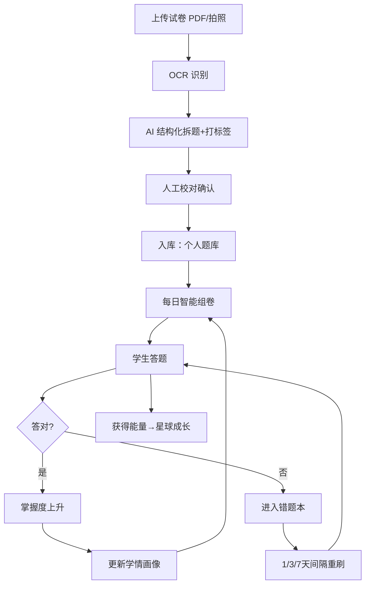

# 智学星球 · 产品需求文档（PRD）

> 一款面向初中生的「真题识别 + 自适应刷题 + 养成打卡」微信小程序

| 项目 | 内容 |
| --- | --- |
| 文档版本 | v1.0 |
| 产品名称 | 智学星球（工作代号） |
| 产品形态 | 微信小程序（前端）+ 微信云开发（后端） |
| 目标学段 | 初中（七、八、九年级），首批聚焦数学、物理、英语 |
| 编写日期 | 2026-11-21 |
| 文档状态 | 评审稿 |

---

## 1. 产品概述

### 1.1 背景与痛点

初中生刷题存在四个典型痛点：

- **试卷用完即扔**：学校发的、自己买的纸质试卷/PDF，做完就堆在角落，错题靠手抄，费时且难以坚持。
- **错题不复盘**：错题抄了也不看，或只看一遍，没有按科学间隔反复重刷，同类错误反复犯。
- **刷题无重点**：学生时间有限，却在已经掌握的题上重复消耗，薄弱知识点得不到针对性训练。
- **缺乏持续动力**：刷题枯燥，孩子没有内在激励，家长只能靠催促，亲子关系紧张。

### 1.2 产品定位

> **把孩子自己的真题试卷，变成会"长脑子"的每日闯关练习册。**

- 不是通用题库 App，而是"**私人试卷资产化**"工具：学生上传自己的真题，系统识别、结构化、智能化重刷。
- 不是冷冰冰的搜题工具，而是"**养成陪伴型**"学习产品：用成长激励把"要我刷"变成"我要刷"。

### 1.3 核心价值主张

1. **真题识别**：上传 PDF/拍照试卷，自动拆题、打知识点标签，沉淀为个人专属题库。
2. **自适应训练**：基于知识点掌握度模型，动态调整出题——盲区高频出现、掌握后逐步"毕业"。
3. **错题反复刷**：错题自动归集，按遗忘曲线（1/3/7 天）间隔重刷，真正攻克。
4. **养成激励**：星球养成、连续打卡、成就徽章、同伴 PK，持续牵引学习行为。

### 1.4 产品目标

| 维度 | 目标 |
| --- | --- |
| 用户价值 | 学生用更少时间，精准攻克薄弱点，减少无效刷题 |
| 体验目标 | 上传一份试卷到生成第一套打卡题，全程 ≤ 3 分钟 |
| 业务目标（一期） | 跑通"上传→识别→打卡→错题重刷"最小闭环，验证留存 |

---

## 2. 用户分析

### 2.1 用户画像

| 角色 | 画像 | 核心诉求 | 在产品中的角色 |
| --- | --- | --- | --- |
| 学生（主用户） | 12–15 岁初中生，课业压力大，喜欢游戏化 | 少刷题、提分、有成就感 | 使用者 |
| 家长（付费决策者） | 30–45 岁，没时间/不会辅导，愿为效果付费 | 看到孩子学情、减负、省心 | 付费者、监督者 |
| 老师（传播节点） | 一线初中老师，希望差异化教学 | 布置作业、掌握班级学情 | 冷启动渠道、B 端付费方 |

### 2.2 核心使用场景

- **场景 A｜试卷入库**：老师发了一张数学月考卷，学生拍照/上传 PDF → 系统识别拆出 12 道题 → 学生快速校对确认 → 入库为个人题库。
- **场景 B｜每日打卡**：放学后打开小程序，系统推送今日 10 题（6 道盲区题 + 3 道错题重刷 + 1 道巩固题），做完获得星球能量。
- **场景 C｜考前冲刺**：期中前，学生在错题本按知识点集中重刷高频错题，掌握度雷达图肉眼可见地"长大"。
- **场景 D｜家长看报告**：家长端收到周报，看到"二次函数图像平移"掌握度仅 62%，选择购买 AI 精讲或打印错题册。

---

## 3. 产品范围与功能架构

### 3.1 功能架构图

```
智学星球小程序
├─ 学员端
│  ├─ 首页（今日打卡入口 / 星球状态 / 连续天数）
│  ├─ 试卷中心
│  │  ├─ PDF 上传 / 拍照上传
│  │  ├─ AI 识别拆题
│  │  └─ 题目校对确认
│  ├─ 每日打卡
│  │  ├─ 智能组卷（盲区+错题+巩固）
│  │  ├─ 在线答题
│  │  └─ 即时批改与解析
│  ├─ 错题本
│  │  ├─ 错题归集
│  │  ├─ 间隔重刷（1/3/7 天）
│  │  └─ 错题打印
│  ├─ 学情画像
│  │  ├─ 知识点掌握度雷达图
│  │  └─ 盲区清单
│  └─ 养成中心
│     ├─ 星球养成
│     ├─ 成就徽章
│     └─ 排行榜 / 组队打卡
├─ 家长端
│  ├─ 周报订阅
│  ├─ 薄弱点预警
│  └─ 学情摘要（可用不可见原始数据）
└─ 老师端（二期）
   ├─ 试卷分发
   ├─ 班级作业布置
   └─ 班级学情看板
```

### 3.2 功能清单与优先级

| 编号 | 功能模块 | 功能点 | 优先级 | 期次 |
| --- | --- | --- | --- | --- |
| F01 | 试卷中心 | PDF/拍照上传试卷 | P0 | 一期 |
| F02 | 试卷中心 | AI 识别拆题（题干/选项/答案/知识点） | P0 | 一期 |
| F03 | 试卷中心 | 人工校对与确认入库 | P0 | 一期 |
| F04 | 每日打卡 | 按掌握度智能组卷 | P0 | 一期 |
| F05 | 每日打卡 | 在线答题与客观题自动批改 | P0 | 一期 |
| F06 | 错题本 | 错题自动归集 | P0 | 一期 |
| F07 | 错题本 | 间隔重刷队列（1/3/7 天） | P0 | 一期 |
| F08 | 养成中心 | 连续打卡 + 星球能量 + 等级 | P0 | 一期 |
| F09 | 学情画像 | 知识点掌握度雷达图 | P1 | 二期 |
| F10 | 养成中心 | 成就徽章 + 皮肤装扮 | P1 | 二期 |
| F11 | 家长端 | 周报 + 薄弱点预警 | P1 | 二期 |
| F12 | 每日打卡 | AI 题目精讲（文字/语音） | P1 | 二期 |
| F13 | 每日打卡 | 变式题 AI 生成 | P2 | 三期 |
| F14 | 养成中心 | 好友排行榜 + 组队打卡 | P2 | 三期 |
| F15 | 老师端 | 试卷分发 + 班级作业 + 学情看板 | P2 | 三期 |
| F16 | 错题本 | 错题一键打印成册 | P2 | 三期 |

> 一期目标：F01–F08，跑通"上传→识别→打卡→错题重刷→养成"最小闭环。

---

## 4. 详细功能需求

### F01 / F02 试卷上传与 AI 识别

**用户故事**：作为学生，我想上传一份试卷 PDF，系统自动把每道题拆出来，这样我不用手抄。

**流程**：
1. 用户选择"上传 PDF"或"拍照上传"。
2. 系统校验文件（格式、大小 ≤ 20MB、页数 ≤ 10）。
3. PDF 转图片 → OCR 识别文字 → AI 大模型结构化拆题。
4. 输出结构化题目：题干、题型（选择/填空/解答）、选项、答案、解析、建议知识点标签。
5. 进入校对页，用户确认/修改后入库。

**验收标准**：
- PDF 上传成功率 ≥ 95%，单页识别耗时 ≤ 8 秒。
- 题目拆分准确率（一期）：印刷体题干 ≥ 90%；复杂公式/几何图形允许标记"需人工确认"。
- 必须提供人工校对环节，未经确认的题目不进入题库。
- 识别失败或低置信度题目高亮提示用户手动录入。

> ⚠️ 关键约束：AI 识别不可能 100% 准确，产品必须把"校对"设计成流畅而非负担的环节（如逐题左右滑动确认）。

### F03 题目校对与入库

- 逐题卡片展示：题干可编辑、选项可编辑、答案单选/多选/文本、知识点标签可增删。
- 知识点标签来自系统预置的「初中知识点树」，AI 预打标签，用户可修正。
- 支持整卷批量确认、跳过存草稿。
- 入库后该试卷归入对应学科/章节/年份，形成个人题库。

### F04 智能组卷（自适应核心）

**出题权重模型**（一版可落地规则）：

```
某题被选中概率 ∝ 
    基础权重(1) 
  + 盲区加权  (1 - 掌握度/100) × W1
  + 错题复现  (是否在重刷队列) × W2
  + 新鲜度衰减 (距上次作答天数) × W3
```

- 每套打卡题默认 10 道：约 6 道盲区题 + 3 道错题重刷 + 1 道已掌握巩固题。
- 同一知识点短时间内不重复出超过 2 道。
- 掌握度 ≥ 85 的知识点逐步降低出现频率（"毕业"机制）。
- 每日组卷在云端完成，结果缓存，保证当天任务稳定。

### F05 在线答题与批改

- 客观题（选择/判断/填空精确匹配）自动批改，即时反馈对错。
- 解答题一期支持"自评对照答案"（用户对比后选"对/错"），二期接入 AI 批改。
- 答错立即弹出简短解析（可折叠），答对给予正反馈动效。
- 答题过程记录：耗时、尝试次数、是否翻看解析，用于掌握度计算。

### F06 / F07 错题本与间隔重刷

- 答错或标记"没掌握"的题目自动进入错题本。
- 每题记录错因标签（知识点漏洞 / 审题偏差 / 计算失误 / 概念混淆）。
- **间隔重刷**：按艾宾浩斯简化排期，答错后第 1、3、7 天各推送一次；连续答对 2 次后移出重刷队列。
- 支持按学科、章节、错因、知识点筛选。
- 错题可取消"已攻克"归档。

### F08 养成激励

**成长主线**：学生答题获得"能量值"，能量滋养一颗专属星球（含等级、外观、住民）。

- 能量规则：完成每日打卡 +20，答对 +2/题，攻克一个薄弱知识点 +30，连续打卡额外加成。
- 星球随等级蜕变：荒芜→萌芽→繁茂→星河…（视觉进阶）。
- 连续打卡日历（签到式），断签有"补签卡"道具。
- 成就徽章：如"七日坚持""错题终结者""数学攻坚手"。

> 设计红线：奖励只绑定**学习行为本身**（做题、攻克盲区、坚持），严禁绑定"在线时长"，避免变相诱导沉迷。

### F09 学情画像（二期）

- 知识点掌握度雷达图（按学科维度）。
- 薄弱知识点 Top10 清单 + 趋势（本周 vs 上周）。
- 答题量、正确率、坚持度趋势曲线。

---

## 5. 核心业务流程



---

## 6. 非功能需求

### 6.1 性能

| 指标 | 要求 |
| --- | --- |
| 单页 OCR+拆题耗时 | ≤ 8 秒（P95） |
| 每日组卷响应 | ≤ 1 秒 |
| 小程序首屏加载 | ≤ 2 秒 |
| 支持并发 | 单云环境 ≥ 200 并发（一期） |

### 6.2 准确率

- 印刷体题目拆分准确率 ≥ 90%（一期目标）。
- 知识点标签 AI 预标注准确率 ≥ 80%，依赖人工校对兜底。
- 客观题自动批改准确率 ≥ 99%。

### 6.3 安全与合规（红线）

- **定位为"学习工具"**，不得提供付费学科课程/培训，规避"双减"监管风险。
- 未成年人个人信息保护：遵循《未成年人保护法》《儿童个人信息网络保护规定》，家长授权、最小化采集。
- 微信平台合规：完成小程序备案、类目资质（教育-在线教育需相应资质，注意工具 vs 培训类目差异）。
- 内容安全：用户上传图片、AI 生成文本需过内容安全检测。
- 数据可用不可见：家长端仅接收学情摘要，不暴露学生原始答题明细之外的隐私。

### 6.4 成本约束

- AI 调用有 token 成本：免费用户设每日识别页数/次数上限（如 3 页/天），付费用户放开。
- OCR 与大模型调用做结果缓存，避免重复消耗。

---

## 7. 数据指标与埋点

| 指标 | 定义 | 目标（一期验证） |
| --- | --- | --- |
| 激活率 | 上传首份试卷 / 新增用户 | ≥ 50% |
| 闭环完成率 | 完成首次打卡 / 上传试卷 | ≥ 40% |
| 次日留存 | 次日回访 | ≥ 35% |
| 7 日留存 | 7 日内回访 | ≥ 20% |
| 人均日答题量 | 日均完成题数 | ≥ 8 |
| 错题重刷完成率 | 完成推送重刷 / 推送 | ≥ 60% |
| 识别成功率 | 成功入库试卷 / 上传试卷 | ≥ 90% |

关键埋点：上传、识别完成、校对确认、组卷、答题、答对/答错、错题重刷、能量获取、打卡完成、留存回访。

---

## 8. 里程碑规划

| 阶段 | 周期（建议） | 交付内容 | 验证目标 |
| --- | --- | --- | --- |
| M0 原型验证 | 1 周 | 高保真原型 + 技术 Demo（识别 1 份卷） | 跑通识别可行性 |
| M1 最小闭环 | 3–4 周 | F01–F08（学员端核心闭环） | 内部/种子用户跑通闭环 |
| M2 体验增强 | 3 周 | F09–F12（雷达图、成就、家长周报、AI 精讲） | 提升留存与付费感知 |
| M3 生态扩展 | 4 周 | F13–F16（变式题、组队、老师端、打印） | B 端冷启动、规模化 |

---

## 9. 风险与依赖

| 风险 | 影响 | 应对 |
| --- | --- | --- |
| OCR 对公式/图形识别差 | 录题质量低 | 人工校对兜底 + 标记需确认 + 二期专项优化 |
| 政策合规 | 产品下架 | 严格定位工具、规避培训类目、备案齐全 |
| 冷启动无试卷 | 无题可刷 | Seed 题库 + 3–5 位老师渠道导入 |
| 巨头竞争 | 增长困难 | 聚焦"私人试卷资产+养成"差异化，不拼题库规模 |
| AI 调用成本 | 亏损 | 免费额度限制 + 缓存 + 付费分层 |

---

*本文档为评审稿，后续根据开发反馈迭代。配套交付：《数据库设计》《高保真页面原型》。*
